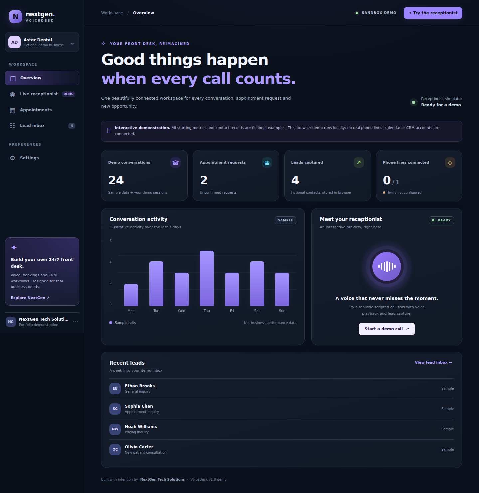

# NextGen VoiceDesk

**Voice receptionist + lead-capture + appointment-request portfolio project.**

[Open the interactive demo](https://rajachanna.github.io/NextGen-AI-Receptionist/) | [NextGen Tech Solutions](https://www.nextgentechdev.com)

> TRANSPARENT DEMO: The online dashboard uses fictional sample contacts and your own browser storage. No real phone line, LLM/AI provider, CRM, calendar, SMS, email or payment provider is connected. The default conversation engine is explicitly RULE-BASED. Appointments are REQUESTS only; they are NOT confirmed.

## What it demonstrates

- Premium responsive dashboard with distinctly labeled sample metrics.
- Browser-based simulated voice calls (speech synthesis and optional speech recognition where supported).
- Conversation intent flows: appointments, prices, business hours, location, human callback.
- Interactive two-step name/contact capture into the browser demo lead inbox.
- Appointment-request form: weekday, 30-minute slots, past-date and duplicate-slot prevention.
- Lead inbox, search, manual entries, JSON export and demo reset.
- Separate Python standard-library backend with real SQLite persistence, admin-key-gated lead, appointment and summary APIs, and optional signed Twilio voice webhooks.
- Reproducible integration tests; GitHub Actions CI.

**What is NOT built:** Real generative AI conversations, phone-call production service, live calendar booking, CRM sync, outbound calls, reminders, staff transfers, payment collection, automated performance analytics or deployed customer production backend. These are paid business-specific integrations to build and verify separately.

## Run locally

Requirements: Python 3.10+ (no pip packages required for the backend).

    git clone https://github.com/rajachanna/NextGen-AI-Receptionist.git
    cd NextGen-AI-Receptionist
    python3 -m unittest discover -s tests -v

    export VOICEDESK_ADMIN_KEY="replace-with-your-own-32-character-random-string"
    export BUSINESS_TIMEZONE="America/New_York"
    python3 server.py --host 127.0.0.1 --port 8974

Then open http://127.0.0.1:8974 to use the browser demo.

Example protected admin API call:

    curl -X POST http://127.0.0.1:8974/api/leads \
      -H "Authorization: Bearer $VOICEDESK_ADMIN_KEY" \
      -H "Content-Type: application/json" \
      -d '{"name":"Example Person","contact":"example@example.test","interest":"Consultation","source":"manual"}'

    curl http://127.0.0.1:8974/api/summary \
      -H "Authorization: Bearer $VOICEDESK_ADMIN_KEY"

Do NOT put the admin secret in a browser application or publish it in GitHub.

## API overview

| Method | Route | Access | Behavior |
| --- | --- | --- | --- |
| GET | /api/health | Public | Status and current assistant mode |
| GET/POST | /api/leads | Admin bearer key | List or save leads |
| GET/POST | /api/appointments | Admin bearer key | List or request appointment slots |
| GET | /api/summary | Admin bearer key | Real database counts |
| POST | /api/message | Admin bearer key | Deterministic intent response; never confirms bookings |
| POST | /twilio/voice | Valid Twilio signature | Automated greeting and gather spoken request |
| POST | /twilio/collect | Valid Twilio signature | Capture callback lead and return scripted response |

## Technical architecture

- web/index.html, web/styles.css, web/app.js: Static interactive showcase, entirely client-side and with fictional data.
- voicedesk/logic.py: Auditable rule-based intent responses and XML escaping helper.
- voicedesk/store.py: SQLite-backed lead and appointment storage, with unique date/time slots and timezone validation.
- voicedesk/api.py: Standard-library HTTP server, protected admin API, optional signed Twilio POST routes.
- server.py: Runnable local entry point.
- tests/test_core.py: Validation, authorization, API, response and Twilio signature tests.
- docs/DEPLOYMENT.md: Deployment constraints and integration plan.

GitHub Pages hosts ONLY the static web demo. The separate Python API cannot run on GitHub Pages.

## Security and readiness

Default listen address is 127.0.0.1. Admin API is disabled unless an environment secret of at least 24 characters is configured. The server restricts body size, limits exposed static files, checks Twilio signature, and uses a transactional unique constraint to prevent duplicate slot requests. It is still a reference backend, NOT a production multi-tenant platform. Production deployments require TLS, perimeter rate limiting, hardened authentication, consent/privacy review, backups, retention/deletion, calendar availability sync and human escalation paths.

The public browser demo never calls the admin API, does not upload contact details and stores sample/demo inputs locally. Browser speech recognition is an optional browser capability; its provider-specific privacy policies may apply when used.

Built for the NextGen Tech Solutions portfolio by Raja Channa. Copyright 2026 NextGen Tech Solutions. All rights reserved unless separately licensed.
